<p align="center">
  <picture>
    <source media="(prefers-color-scheme: dark)" srcset="docs/images/tandem-wordmark-white.png">
    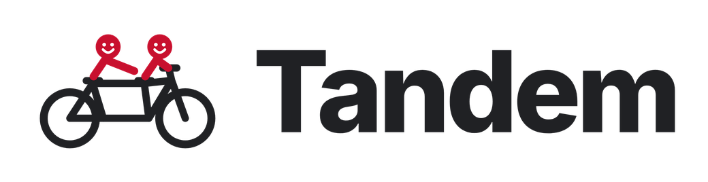
  </picture>
</p>

<h3 align="center">Find your people. Find your Calgary.</h3>

<p align="center">
  A group-first way for Calgarians, newcomers and visitors to find people to do things with,<br>
  so that walking in alone is never the hard part.
</p>

<p align="center">
  <a href="https://youtu.be/-TkNc9h2p-Q"></a>
  
  
  
  
</p>

<p align="center">
  <a href="https://youtu.be/-TkNc9h2p-Q">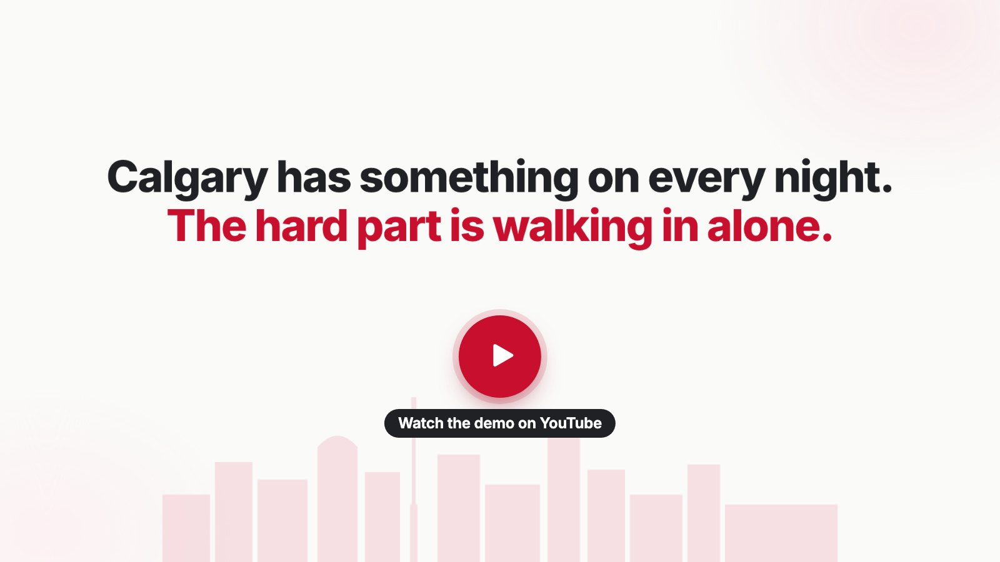</a>
</p>

<p align="center">
  <a href="https://youtu.be/-TkNc9h2p-Q"><b>Watch the demo</b></a> ·
  <a href="#a-walk-through-the-app">See the app</a> ·
  <a href="#accessibility-and-trust">Accessibility and trust</a> ·
  <a href="#how-its-built">How it's built</a> ·
  <a href="#run-it-locally">Run it locally</a>
</p>

> *Tandem doesn't measure how many people follow you. It helps you find people to go somewhere with.*

Built in Calgary for **Code the Change 2026** by **LeGroup** (Falah Sheikh and Hunter Halvorson), for Prompt 1:
*How can we leverage technology to promote health, social connection and well-being in our communities?*
The name comes from the tandem bicycle: people moving together toward the same place.

---

## Why Tandem

Calgary has something on every night: run clubs, book clubs, hikes, jam sessions, volunteer shifts. For a lot of
people the hard part isn't finding an event. It's walking in alone. Social apps count followers and likes, which
makes that first step harder, not easier.

<table>
  <tr>
    <td width="50%">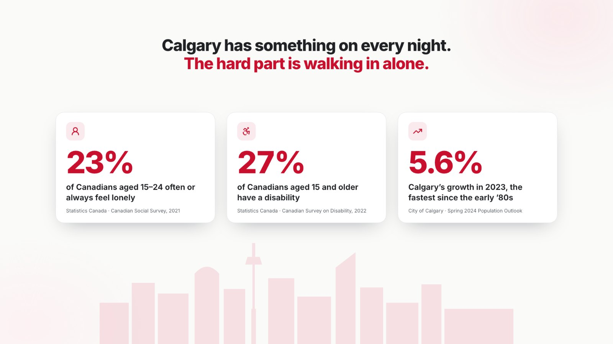</td>
    <td width="50%">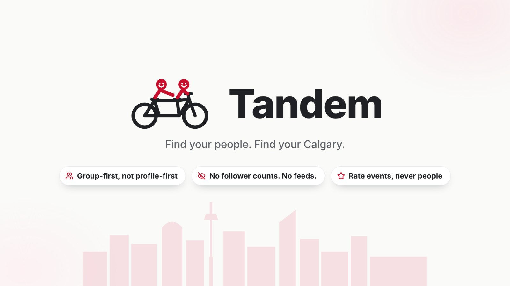</td>
  </tr>
</table>

Sources: [Statistics Canada, Canadian Social Survey (2021)](https://www150.statcan.gc.ca/n1/daily-quotidien/211124/dq211124e-eng.htm) ·
[Statistics Canada, Canadian Survey on Disability (2022)](https://www150.statcan.gc.ca/n1/daily-quotidien/231201/dq231201b-eng.htm) ·
[City of Calgary, Spring 2024 Population Outlook](https://calgary.ca/content/dam/www/cfod/finance/documents/corporate-economics/calgary-and-region-economic-outlook/spring-2024-calgary-and-region-population-outlook-2024-2029.pdf)

Tandem is **group-first, not profile-first**: no follower counts, no likes, no feeds and no ratings of people. You
find an activity, see exactly what to expect, say hi to the group before you go, and rate the event afterwards.
Showing up earns *Tandem Miles*; popularity earns nothing.

## A walk through the app

Meet Riley: visiting Calgary for ten days, and anxious in big groups. Every screen below is the running app.

<table>
  <tr>
    <td width="50%" valign="top">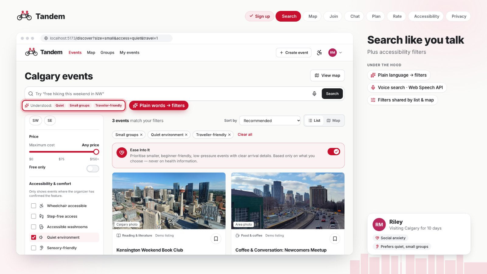<br>
      <b>Search like you talk.</b> Plain words, or your voice, become real filters. Accessibility filters only count what organizers have confirmed.</td>
    <td width="50%" valign="top">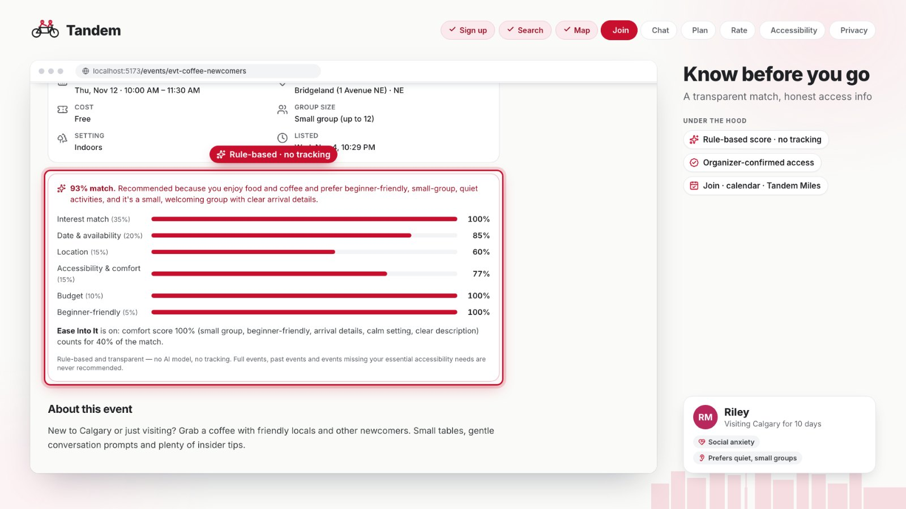<br>
      <b>Every match explains itself.</b> A rule-based score from interests, timing, distance, access and budget. No AI model, no tracking.</td>
  </tr>
  <tr>
    <td valign="top">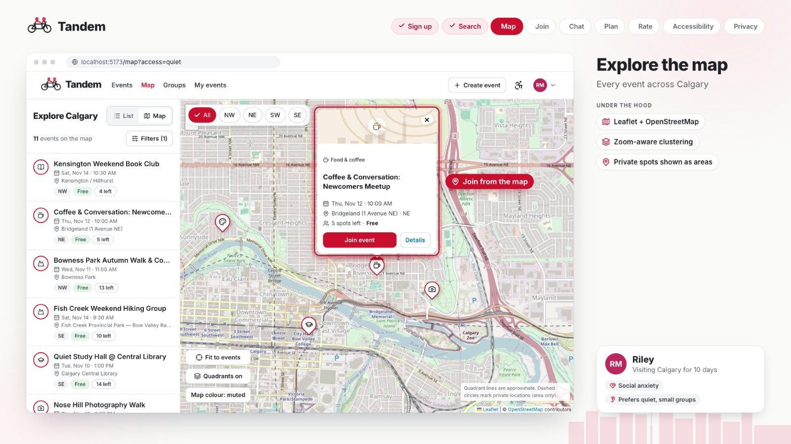<br>
      <b>One set of filters, two views.</b> The map and the list share the same filters. Private homes only ever show as an approximate area.</td>
    <td valign="top">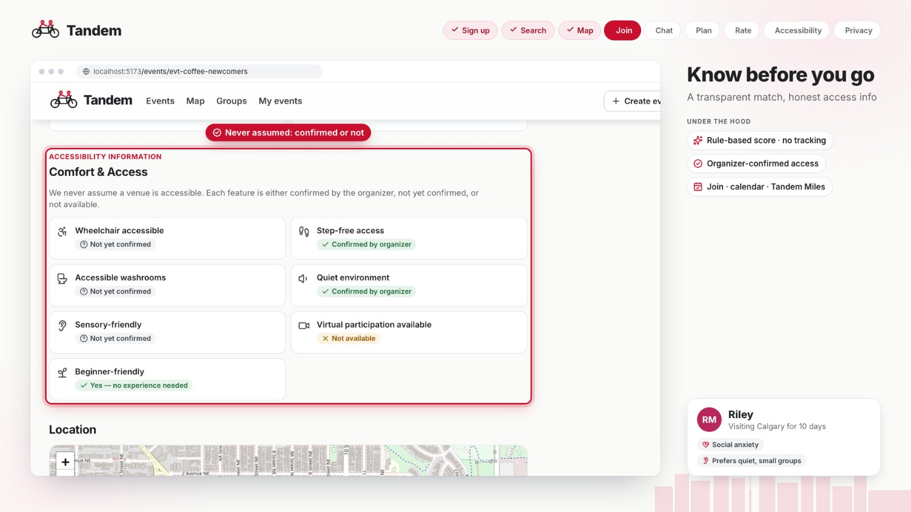<br>
      <b>Know before you go.</b> First-Time Friendly details, and access that is confirmed by the organizer, not yet confirmed, or not available. Never assumed.</td>
  </tr>
  <tr>
    <td valign="top">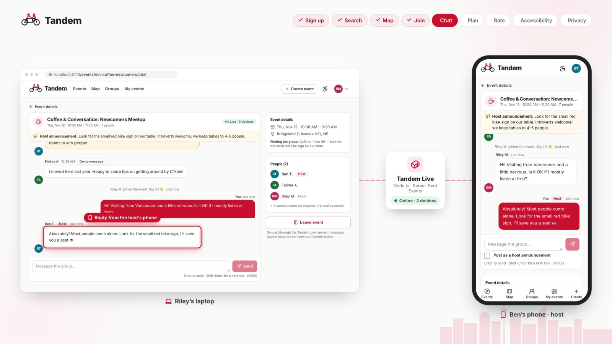<br>
      <b>Say hi before you arrive.</b> Joining unlocks the group chat. Tandem Live syncs every device in about a tenth of a second.</td>
    <td valign="top">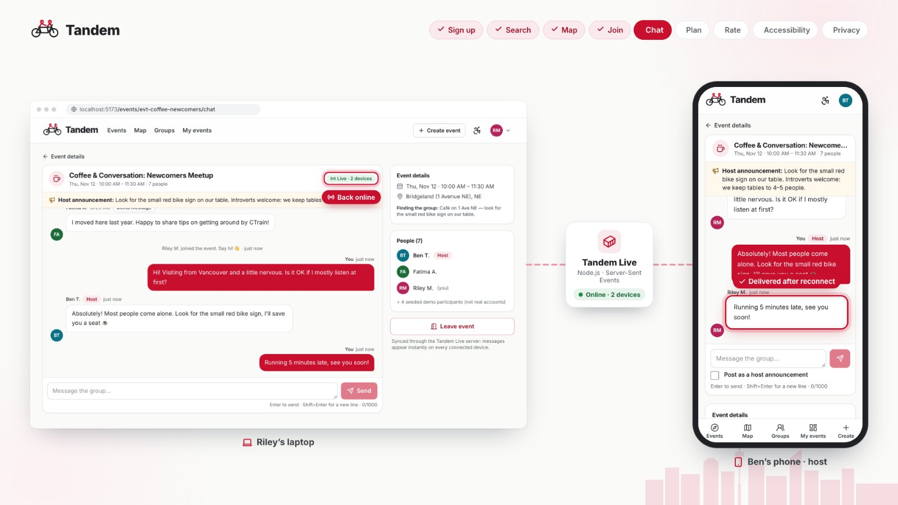<br>
      <b>Keeps working when the server doesn't.</b> Messages are saved on the device and delivered once the server is back.</td>
  </tr>
  <tr>
    <td valign="top">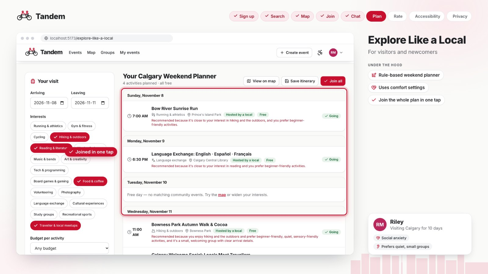<br>
      <b>Explore Like a Local.</b> Visitors get a weekend plan built from their interests and comfort settings, and join the whole plan in one tap.</td>
    <td valign="top">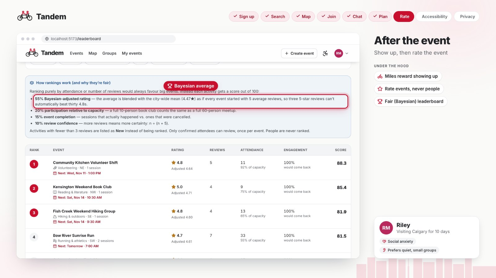<br>
      <b>Rate events, never people.</b> Confirmed attendees rate the event once. A Bayesian leaderboard stops a few lucky five-star reviews from outranking events that are consistently great.</td>
  </tr>
  <tr>
    <td valign="top">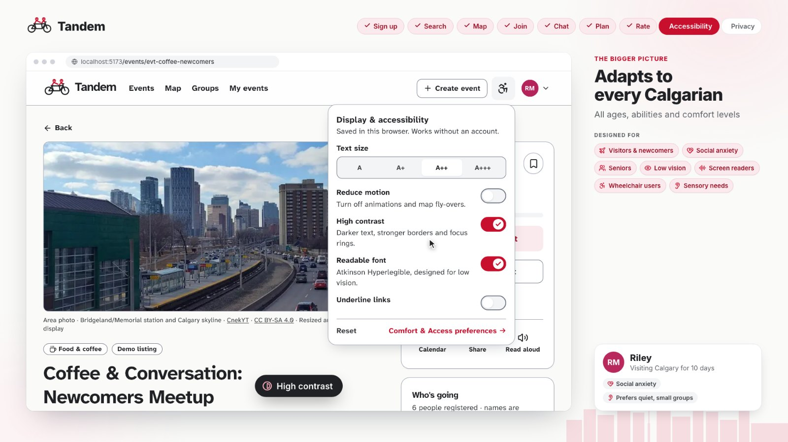<br>
      <b>Adapts to every Calgarian.</b> Text size, high contrast, reduced motion and a low-vision font change every screen instantly, with no account. Any event can be read aloud.</td>
    <td valign="top">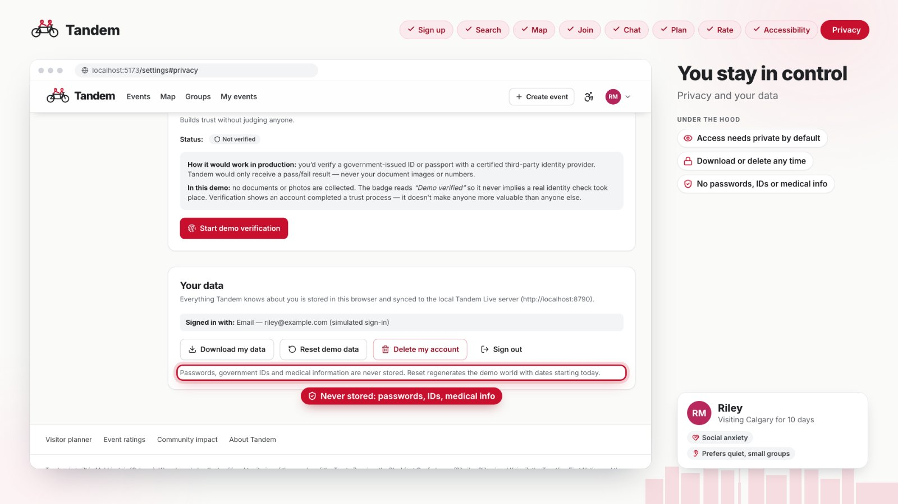<br>
      <b>You stay in control.</b> Choose who sees what. Download or delete your data any time. Passwords, IDs and medical details are never stored.</td>
  </tr>
</table>

<details>
<summary><b>Everything else in the app</b></summary>

| Area | Highlights |
|---|---|
| **Discovery** | Cards with date, quadrant, price, capacity, demo-verified host, ratings and confirmed accessibility. Filters: price slider ($0–$150+), free only, categories, quadrant, date presets and custom range, group size, seven accessibility features, spaces left, verified host, traveller-friendly, indoor/outdoor. Seven sort orders. Plain-language and voice search. |
| **Calgary map** | Leaflet and OpenStreetMap, quadrant overlay (NW/NE/SW/SE), category-icon markers (never colour-only), zoom-aware clustering, popups with Join, list/map toggle. Filters live in the URL, so list and map always agree. |
| **Hosting** | Single-page create/edit form with templates, public place picker or drop-a-pin, private/residential mode, First-Time Friendly details, tri-state accessibility, cancel with a reason, calendar (.ics) export, share, read aloud. |
| **Group chat** | Per event, attendees and host only. Host announcements, participants list, leave event, report a message. Live across devices with Tandem Live or Supabase. |
| **Explore Like a Local** | Travel mode with dates, budget and areas; a rule-based Weekend Planner (real events only, no overlaps); *Join all*; save to the dashboard. |
| **Groups** | Twelve community groups with organizers, guidelines, upcoming and past events, join/leave. |
| **Reviews and Tandem Miles** | Only checked-in attendees can review, once per event. Miles come from showing up and hosting, with six milestones, and are never ranked publicly. |
| **Community impact** | A live dashboard of community activity, computed from the data and labelled as demo data. |

Event and group pages use Calgary photography from Wikimedia Commons, with the place, photographer and licence shown.
</details>

## Accessibility and trust

- **Checked, not just claimed.** axe-core finds **0 violations across 18 pages** (WCAG 2.0, 2.1 and 2.2 A/AA plus best
  practices). The map works by keyboard, focus is managed between pages, and no information relies on colour alone.
- **Comfort & Access preferences**: small groups, quiet spaces, sensory-friendly, beginner-friendly and must-have
  access features. They are practical, private by default, and never medical labels.
- **Ease Into It** re-ranks every list toward low-pressure events: small groups, clear arrival details, calm settings.
- **Display & reading menu** in the header, no account needed: text size, high contrast, reduced motion, underlined
  links and Atkinson Hyperlegible Next. **Read aloud** and **voice search** use the browser's own Web Speech API.
- **Honest by design.** Access is only shown as confirmed when the organizer confirmed it. Seeded content is labelled
  as demo data. The simulated ID check says *Demo verified*. Recommendations show their maths. People are never rated.
- **Private by default.** No passwords, government IDs, medical information or home addresses are stored. Private event
  locations show an approximate area. Your data can be downloaded or deleted at any time.

## Made for Calgary

- **Calgary built in**: quadrants, neighbourhoods and real public venues such as the Central Library, Prince's Island
  Park, Bowness Park and Fish Creek.
- **For newcomers and visitors**: travel mode, the Explore Like a Local planner and traveller-friendly hosts.
- **For the people who already bring Calgary together**: community associations, libraries, newcomer centres and clubs
  can publish events from templates and confirm their accessibility.
- **Free to run**: no paid APIs, OpenStreetMap tiles, a zero-dependency sync server, and Supabase for a city-wide rollout.

## How it's built

<p align="center">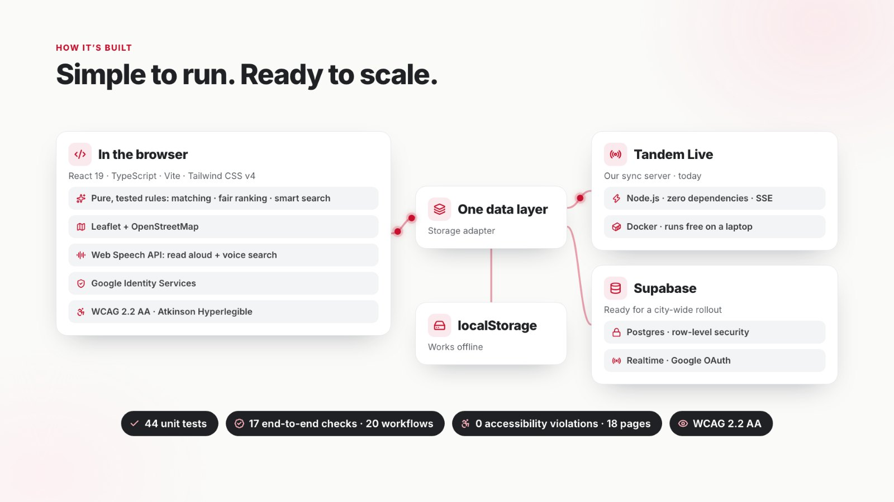</p>

| Layer | What we used |
|---|---|
| App | React 19, TypeScript 5.9, Vite 8, Tailwind CSS v4, React Router 7, lucide icons, Inter and Atkinson Hyperlegible Next |
| Logic | Pure functions `(db, input, now) → result` for recommendations, filters, smart search, the weekend planner, the leaderboard and Tandem Miles, all unit-tested |
| Map | Leaflet 1.9 and React-Leaflet 5 with OpenStreetMap tiles and zoom-aware clustering |
| Data | One storage adapter: localStorage (works offline), then Tandem Live for shared demos, then Supabase |
| Sync | **Tandem Live** (`server/live-server.mjs`): Node.js with zero dependencies, Server-Sent Events, entity-level updates, atomic JSON persistence, input validation, Docker image |
| Shared mode | Supabase Postgres with row-level security, security-definer RPCs, row locks for event capacity, Realtime and Google OAuth |
| Sign-in | Google Identity Services; the ID token's audience, issuer and expiry are checked and the token is never stored |
| Quality | Vitest, headless-Chrome end-to-end checks, axe-core accessibility audit, oxlint |

<details>
<summary><b>The algorithms</b></summary>

**Recommendations** (`frontend/src/services/recommendations.ts`)
1. Hard constraints first: never recommend events that are cancelled, private, already started, full, already joined
   or hosted by you, over a budget you marked as strict, outside your travel dates, or missing an access feature you
   marked as a must-have.
2. Weighted score: interests 35%, date and availability 20%, location 15%, accessibility and comfort 15%, budget 10%,
   beginner-friendly 5%. Related interests count partially (hiking and photography, for example).
3. Ease Into It blends in a comfort score: `final = 0.6 × base + 0.4 × comfort`.
4. Every recommendation says why, and the event page shows the per-factor breakdown.

**Fair leaderboard** (`frontend/src/services/leaderboard.ts`)
`score = 0.55 × Bayesian rating + 0.20 × attendance vs. capacity + 0.15 × completion + 0.10 × review confidence`,
with `Bayesian = (C·m + Σ ratings) / (C + n)`, the city-wide mean `m`, `C = 5` and `confidence = n / (n + C)`.
Activities with fewer than three reviews are listed as **New** instead of being ranked.

**Tandem Miles** (`frontend/src/services/miles.ts`)
Attending a confirmed event +10, hosting an event that happens +15, first event in a new interest +5, volunteering +10.
Miles are derived from attendance records, so they can't be farmed.

**Weekend planner** (`frontend/src/services/itinerary.ts`)
Highest-scoring matching events first, at most N a day, a 45-minute buffer between activities, no repeated category on
the same day, and only events that pass the hard constraints.

**Live sync** (`frontend/src/services/liveSync.ts`)
Each save is diffed into put/delete operations by id and posted to Tandem Live; other devices receive them over
Server-Sent Events. If the server is unreachable the app keeps working in the browser, then sends what changed while
offline when it reconnects.
</details>

## Run it locally

Requires Node 20 or later (tested on Node 22). No API keys, accounts or paid services are needed; the map loads
OpenStreetMap tiles, so it needs internet.

```bash
npm install      # from the repo root (also installs frontend/)
npm run dev      # http://localhost:5173
```

**Demo accounts** (simulated sign-in, no passwords). Choose one on the sign-in page:

| Account | Persona | Try |
|---|---|---|
| **Alex Rivera** | New to Calgary, UCalgary student (NW) | Recommendations, join an event and chat, then *My events → Calgary Tech Coffee Meetup → Rate activity* |
| **Sam Okafor** | Visiting from Toronto, travel mode on | *Explore Like a Local* and the Weekend Planner |
| **Priya Sharma** | Organizer of Calgary Sunrise Runners | Hosting: edit or cancel events, post announcements in chat |

Seeded event dates are generated relative to the day you first open the app. *Settings → Your data → Reset demo data*
starts a fresh world dated today.

### Live sync across devices (optional)

```bash
npm run build && npm run live    # app + sync server on http://<this laptop's IP>:8787 for every device on the Wi-Fi
docker compose up --build        # or the same thing in one container (data kept in a volume)
```

With `npm run dev`, also run `npm run live` in a second terminal; the app connects to port 8787 on the same host.
If the server stops, the app falls back to browser-only mode and catches up when the server returns. The demo server
has no authentication, so use it on a trusted network.

<details>
<summary><b>Shared workspace with Supabase</b></summary>

1. Create a Supabase project and apply the [collaboration](supabase/migrations/20261107000000_collaboration.sql) and
   [activity ratings](supabase/migrations/20261107000100_activity_ratings.sql) migrations in order.
2. Enable the Google provider in Supabase Auth, configure the Google OAuth client with the callback URL Supabase shows,
   and allow your app's `/login` callback in the Auth URL configuration.
   ([Supabase Google setup](https://supabase.com/docs/guides/auth/social-login/auth-google))
3. Add the project's URL and publishable key to `frontend/.env.local` and restart Vite:
   ```dotenv
   VITE_SUPABASE_URL=https://YOUR_PROJECT.supabase.co
   VITE_SUPABASE_PUBLISHABLE_KEY=YOUR_PUBLISHABLE_KEY
   ```
4. Sign in with Google in two browser profiles, join the same event and chat.

In shared mode, sign-in, events, RSVPs, attendance, group membership, chat and new ratings use Supabase; reports and
most profile preferences stay in the browser. Database regression tests:
`psql "$TANDEM_TEST_DATABASE_URL" -v ON_ERROR_STOP=1 -f supabase/tests/collaboration.sql`.
</details>

<details>
<summary><b>Google sign-in for the browser-only demo</b></summary>

1. In the [Google Cloud console](https://console.cloud.google.com/), open **Google Auth Platform**, set the app name and
   a support email, and choose audience **External**. While the app is in *Testing*, add your testers' Google accounts.
2. **Clients → Create client → Web application**, with `http://localhost:5173` and `http://localhost` as authorised
   JavaScript origins (add a deployed URL later). No redirect URI is needed.
3. Put the client id in `frontend/.env.local` (see `frontend/.env.example`) and restart `npm run dev`:
   `VITE_GOOGLE_CLIENT_ID=1234567890-abc123.apps.googleusercontent.com`

A web client id is public by design. This prototype checks the ID token in the browser; production should verify it on
a server.
</details>

## Testing

| Command | What it checks | Result |
|---|---|---|
| `npm test` | 44 Vitest specs: onboarding, recommendations, filters, map markers, joining and capacity, chat, Miles, reviews, leaderboard, traveller dates, live-sync merging | all pass |
| `npm run e2e` | Real Chrome (headless, DevTools Protocol) through all 20 core workflows, including a 390 px phone viewport | 17/17 checks |
| `npm run a11y` | axe-core WCAG 2.0/2.1/2.2 A and AA plus best practices on 18 pages | 0 violations |
| `npm run e2e:live` | Two browsers synced through a test Tandem Live server: RSVPs and chat arrive without a reload; the app falls back when the server stops and catches up on restart | 6/6 |
| `npm run test:live` | Sync server: broadcast between devices, input validation, persistence across restarts | pass |

`e2e`, `a11y` and `e2e:live` need the dev server running. Set `CHROME_PATH` or `BASE_URL` to point them elsewhere.

## Project structure

```
frontend/            React app (Vite)
  src/services/      pure, tested logic: recommendations, filters, nlp, itinerary, leaderboard, miles, liveSync…
  src/pages/         one file per route
  src/components/    UI kit, brand, layout, events, filters, map
  src/data/          Calgary geography, categories, accessibility features, seed data
  scripts/e2e/       headless-Chrome end-to-end and accessibility checks
server/              Tandem Live sync server (Node.js, no dependencies) and its tests
supabase/            migrations and SQL tests for the shared workspace
demo-video/          how the demo videos are made: capture real screens, animate, render with ffmpeg
docs/                README images and the hackathon brief
```

## Limitations and what's next

| Today (prototype) | Next |
|---|---|
| Browser-only demo, or Tandem Live on a trusted network without accounts | Supabase shared workspace with real accounts and row-level security (already built, needs hosting) |
| Google sign-in checked in the browser; email and demo sign-in are simulated | Server-side token verification and multi-factor sign-in |
| *Demo verified* badge; no documents are collected | A certified ID provider that returns only pass or fail |
| Attendance is self-reported | Host-confirmed QR check-in |
| Reports are stored locally | A moderation queue with response times and rate limiting |
| Fictional events at real public venues, with approximate coordinates and quadrant lines | Events from community associations, libraries and newcomer organisations |

## Team and credits

**LeGroup**: Falah Sheikh and Hunter Halvorson, for Code the Change 2026 in Calgary.

Map data © OpenStreetMap contributors · Leaflet · lucide icons · Inter (Rasmus Andersson) · Atkinson Hyperlegible Next
(Braille Institute) · Calgary photography from Wikimedia Commons (credits on each page). Built in Mohkinstsis (Calgary),
on Treaty 7 territory.
